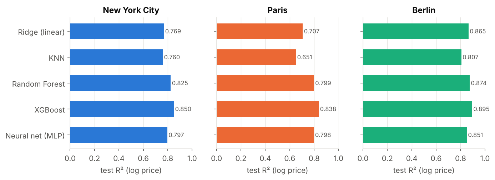

# Predicting Airbnb Listing Price Across Different Cities

**UE24CS352A Machine Learning, Mini Project 71**

| Team member | SRN |
|---|---|
| Dhanush S S | PES1UG24AM082 |
| Harsha K R | PES1UG24AM114 |

Reference: Luo, Zhou and Zhou, *Predicting Airbnb Listing Price Across Different Cities*,
Stanford CS229 (Autumn 2019).

## Problem

Airbnb hosts set nightly prices by guesswork. Given a listing's attributes (size, room type,
location, amenities, reviews, host details and its text description), we predict its nightly
price, and we study whether a model trained in some cities can price listings in a city it
has never seen.

## Dataset

[Inside Airbnb](https://insideairbnb.com/get-the-data/) detailed listings for **New York City,
Paris and Berlin**, scraped June/July 2026 (see [data/README.md](data/README.md)).

| City | Raw listings | With a price | Used (10 to 1000 USD) |
|---|---|---|---|
| New York City | 30,259 | 21,515 | 20,890 |
| Paris | 77,679 | 48,402 | 46,000 |
| Berlin | 12,776 | 8,441 | 8,332 |

Paris and Berlin prices are in EUR and are converted to USD at a fixed rate (1 EUR = 1.15 USD).
Each city is split 80/20 into train and test with a fixed seed; every experiment is scored on
the same test listings.

## Approach

1. **Cleaning** (`src/airbnb/data.py`): parse prices, drop listings without a price or outside
   10 to 1000 USD, parse bathrooms from text (with a shared-bath flag), clean HTML from
   descriptions, compute distance to the city centre and review ages. Columns that leak the
   price (`price_quote_*`, `estimated_revenue_l365d`) are never used.
2. **Target**: `log(price)`. Prices are heavily right-skewed; the log is close to normal
   ([figure](results/figures/price_distribution.png)).
3. **Features** (`src/airbnb/features.py`), 189 in total, in four groups:
   - **C, continuous** (35 columns + 20 missing-value flags): size, stay rules, availability, reviews and scores, host
     details, licence, amenity count, description length, distance to centre, lat/lon;
     median-imputed with missing-value indicators, standardised.
   - **O, categorical**: room type and property type (one-hot) plus the 60 most common
     amenities (multi-hot), 84 columns.
   - **T, text**: TF-IDF of title + description (uni- and bi-grams) reduced to 50 dimensions
     with truncated SVD.
   - **city** one-hot, for the final multi-city model only.
4. **Models** (`src/airbnb/models.py`): Ridge regression and KNN (baselines), Random
   Forest, XGBoost (tuned with 3-fold random search on NYC, `scripts/tune_xgb.py`) and a
   neural network (MLP, 64-32 hidden units, early stopping).
5. **Metrics**: R² and MSE on log price (as in the reference), plus R², MAE and median
   absolute percentage error in dollars.

## Results

**E1. Model comparison inside each city** (test R² on log price; MAE in USD)

| Model | NYC R² | Paris R² | Berlin R² | NYC MAE | Paris MAE | Berlin MAE |
|---|---|---|---|---|---|---|
| Ridge (linear) | 0.769 | 0.707 | 0.865 | $64 | $74 | $45 |
| KNN | 0.760 | 0.651 | 0.807 | $64 | $79 | $51 |
| Random Forest | 0.825 | 0.799 | 0.874 | $55 | $64 | $43 |
| **XGBoost** | **0.850** | **0.838** | **0.895** | **$50** | **$57** | **$39** |
| Neural net (MLP) | 0.797 | 0.798 | 0.851 | $60 | $65 | $48 |

XGBoost is best in every city. The reference report reached 0.74 (NYC) and 0.70 (Paris) with
2019 data.



**E2. Feature groups** (XGBoost, test R²): continuous features alone already give 0.84 / 0.82
(NYC / Paris); adding categorical and amenity features lifts this to 0.86 / 0.83; text adds
little on top (0.85 / 0.84) because most of what the description says is already in the
structured columns.

**E3. One model for several cities.** Training a single model on NYC + Paris scores 0.836 on
NYC and 0.825 on Paris, almost the same as the separate city models (0.844 and 0.829).

**E4. Predicting a city never seen in training (Berlin)**, no lat/lon or city features:

| Trained on | R² on Berlin test | MAE |
|---|---|---|
| NYC | 0.226 | $144 |
| Paris | **0.770** | $61 |
| NYC + Paris | 0.694 | $71 |
| Berlin itself (reference) | 0.892 | $39 |

A Paris model transfers well to Berlin, a NYC model does not. Since NYC's 2023 short-term
rental law (Local Law 18), 78% of NYC listings require stays of 28+ nights (14% in Paris,
20% in Berlin), so NYC prices follow different rules. Unlike the reference report, adding NYC
to Paris *hurts* transfer to Berlin: a similar market matters more than more data.

**Final model**: XGBoost on all three cities with a city indicator
(`models/xgb_all_cities.joblib`): test R² 0.847 (NYC), 0.835 (Paris), 0.895 (Berlin); median
error about 15% of the price.

## Repository layout

```
├── app/app.py                 Streamlit demo (interactive price predictor)
├── data/
│   ├── raw/                   Inside Airbnb listings.csv.gz for the 3 cities
│   └── processed/             cleaned table produced by prepare_data.py
├── models/xgb_all_cities.joblib   trained final model + defaults used by the demo
├── notebooks/airbnb_price_prediction.ipynb   EDA + walkthrough of all results
├── report/                    two-page write-up (PDF + HTML source)
├── slides/                    presentation (PPTX + PDF)
├── results/                   metrics (CSV/JSON) and figures for every experiment
├── scripts/
│   ├── download_data.py       fetch raw data if missing
│   ├── prepare_data.py        step 1: clean + feature columns
│   ├── tune_xgb.py            optional: XGBoost hyper-parameter search
│   ├── train.py               step 2: all experiments + final model
│   └── predict.py             command-line prediction (demo)
└── src/airbnb/                library code: config, data, features, models, evaluate, plots, inference
```

## How to run

Python 3.10+ is needed.

```bash
python -m venv .venv
source .venv/bin/activate          # Windows: .venv\Scripts\activate
pip install -r requirements.txt

python scripts/prepare_data.py     # ~20 s: data/raw -> data/processed
python scripts/train.py            # ~10-15 min: all experiments, figures, final model
                                   # (add --quick to run only Ridge + XGBoost in E1)
```

The processed data, results and trained model are already in the repo, so the demo works
without retraining:

```bash
# Command line
python scripts/predict.py --city paris --room-type "Entire home/apt" --accommodates 4 --bedrooms 2
python scripts/predict.py --city nyc --room-type "Private room" --accommodates 2 \
    --amenities "wifi,kitchen,air conditioning" --text "Cozy room near Central Park"
python scripts/predict.py --sample 5      # real held-out listings: actual vs predicted

# Web app
streamlit run app/app.py

# Notebook
jupyter notebook notebooks/airbnb_price_prediction.ipynb
```

If loading the saved model fails because your scikit-learn or XGBoost version differs, run
`python scripts/train.py` once to rebuild it.

## Limitations

- Prices are the nightly rate Airbnb quoted for one stay at scrape time, not booked prices.
- One fixed EUR to USD rate; seasonality and dates are not modelled.
- Feature importance from gradient boosting shows association, not causation.
